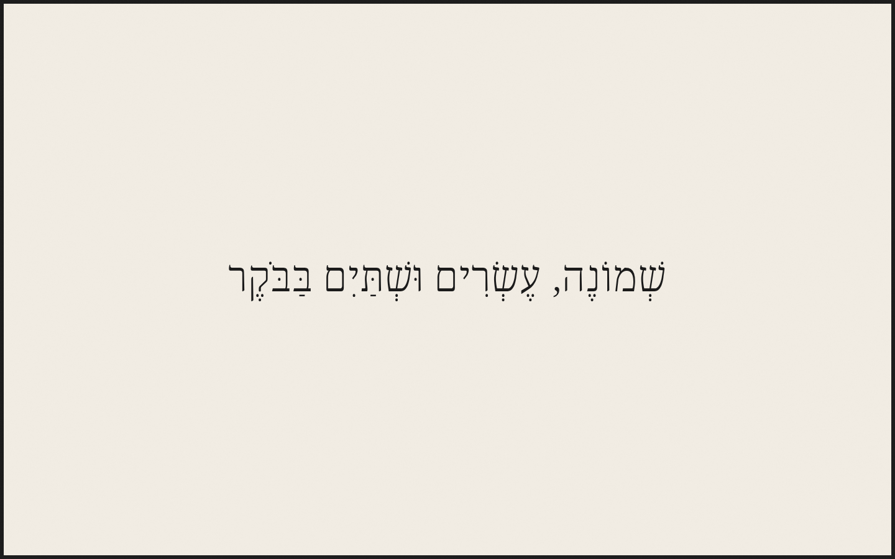
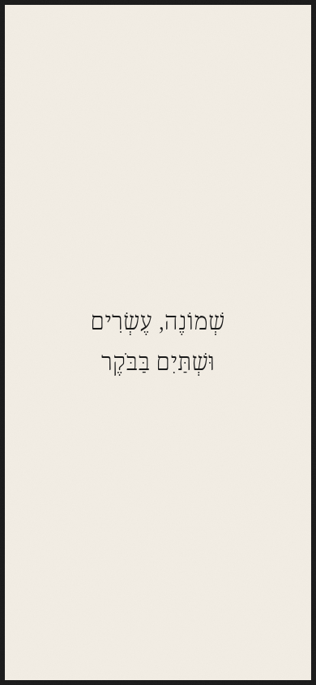

# Hebrew Word Clock · שעון עברי

A minimalist clock that writes the time in Hebrew words, with nikud and right-to-left typography. Available as a browser-based HTML clock and as Arduino firmware for a dedicated ePaper display.

## Choose your version

| Version | Get started |
| --- | --- |
| HTML / browser | [HTML source](index.html) — open directly in a browser, or serve as a static website. |
| Arduino / ePaper | [Build and upload guide](arduino/README.md) — PlatformIO and Arduino IDE instructions. |

**Live HTML version on Vercel:** [Open the Hebrew Word Clock](https://hebrew-clock-six.vercel.app/).

## Webpage screenshots

Actual browser captures of this repository's HTML page, served locally, at desktop and mobile viewport sizes. The browser clock uses your device's local time.

### Desktop



### Mobile



## Arduino build and required hardware

Use the **[Seeed Studio XIAO 7.5-inch ePaper Panel](https://www.seeedstudio.com/XIAO-7-5-ePaper-Panel-p-6416.html)** — the integrated **XIAO ESP32-C3**, **4 MB flash**, **800 × 480 monochrome** panel with **UC8179** controller. This firmware does not target the ESP32-S3 variant or an arbitrary standalone ePaper display. No manual rewiring is needed for the integrated product.

You will also need a **USB-C data cable**, USB power and a **2.4 GHz Wi-Fi network** for initial time synchronization.

### Quick start

1. Install [PlatformIO](https://platformio.org/install).
2. Copy `arduino/hebrew_clock/secrets.example.h` to `arduino/hebrew_clock/secrets.h` and enter your Wi-Fi credentials. This file is git-ignored.
3. Connect the panel over USB and turn its power switch on.
4. From the repository root, build and upload:

```sh
pio run
pio run --target upload --upload-port /dev/ttyACM0
```

Replace `/dev/ttyACM0` with your device's port, such as `COM5` on Windows.

After upload, open `http://<device-ip>/` on your LAN for diagnostics and persistent timezone/syslog settings. The firmware defaults to Israel time with automatic daylight saving and refreshes the display once per minute.

See the **[complete Arduino guide](arduino/README.md)** for Arduino IDE setup, troubleshooting, timezone configuration and hardware verification. This is a USB-powered-first build; deep-sleep battery optimization is not implemented.
